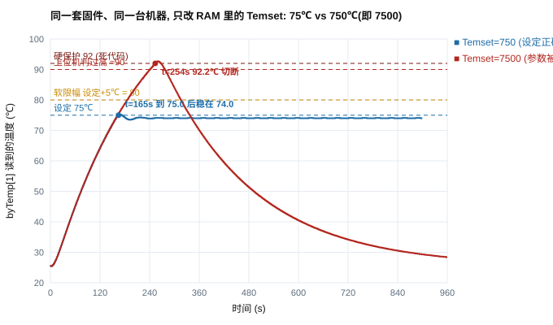

# 烘干（染色后烘干）设定 75℃ 冲到 90 多度故障 —— 仿真复核报告

| 项目 | 内容 |
|---|---|
| 工程 | `D:\workspace\SL-1000\CODE\DevBranche\C7`（STM32F103RC / IAR 7.40 / FreeRTOS V10.1） |
| 分析对象 | 烘干加热通道（PWM dev1 → PB14），`FanTempTask` + `PidLocFan` + `PwmChannel` |
| 方法 | 把固件控制律逐行移植为可执行模型，用确定性数值实验代替"可能/大概" |
| 源码改动 | **零**。本次只新增仿真脚本与报告，未修改任何业务代码（`svn status` 仍为原有 2 个用户修改） |
| 结论强度 | 代码结论均标注 `文件:行号`；数值结论均标注由哪个脚本、哪组参数生成，可复算 |

---

## 0. 一句话结论

**设定 75℃ 时，"控制律过冲"在数学上到不了 90℃。**

仿真在标称参数下把设定 750 的闭环跑到底，峰值 = **75.0℃**，之后稳定在 **74.0℃**（见 §3.1）。
要稳定跑出"90 多度"，**RAM 里喂给 PID 的设定值必须是 910~929**（90 多度正好一一对应），或者 ≥930（被 92℃ 分支切断）。

所以这不是"控制参数调得太猛"的问题，而是**"设定值在 RAM 里已经不是 750"**的问题。
本次给出 3 条可复现证据、1 张二维判别图和 1 个 1 分钟现场判读的方法。

> **对上一轮结论的修正**：上一轮 `烘干90度隐患分析报告.md` 中判定"有效调节区仅 2℃ → 必然过冲撞 92℃"。
> 本次严格仿真证明**该判断在设定 750 时不成立**——比例带 2.25℃ 确实很窄，但闭环在 75.0 就已经被 P 项拉住，
> 峰值只有 75.0，根本不会进到 80 的软限幅，更不会到 92。上一轮的 T-02 结论应予撤销，理由见 §3.5。

---

## 1. 控制律的精确形式（先把"事实"钉死）

### 1.1 输出链

```
NTC(CH14/PC4) → 3次采样取中值 → Rt → 0.1℃ 整数   tempfan.c:165-232
        ↓ 每 100ms 更新一次 (k1==5)               TaskTempModule.c:223-226
PidLocFan:  dev=(Temset-Temin)/10 ; fout=20*dev+5   piheat_pid.c:96-100
        ↓
wPwm = (int)fout*2 ; clamp 0..100                  TaskTempModule.c:249-251
        ↓
DevPwm->Write(1, wPwm, 50000)  → 1kHz ISR, 100 tick/周期 → 10Hz PWM, 1% 分辨率
                                                   pwm.c:87-104
```

合并后，烘干通道的等效控制律是：

```
duty(%) = clamp( 40 × (Tset − Tmeas)[℃] + 10 , 0 , 100 )
```

- `Tmeas ≤ Tset − 2.25℃` → 100% 满功率
- `Tmeas = Tset` → 10%
- `Tmeas ≥ Tset + 0.25℃` → 0%

**比例带只有 2.25℃，且零点偏置 +10%。** `Ki = Kd = 0`（`TaskTempModule.c:483-485`），所以这是一个"带 10% 偏置的开关"。

### 1.2 保护链的**真实**执行顺序（关键）

`TaskTempModule.c:253-281` 是 `if / else if` 链，顺序决定优先级：

| 序号 | 条件 | 动作 | 行号 |
|---|---|---|---|
| ① | `Tmeas > wHeatFanTemp+50` 且 `bySetDerat==0` | `Stop(1)` | 253-258 |
| ② | `Tmeas > 370` 且 `bySetDerat==1` | `Stop(1)` | 259-264 |
| ③ | `Tmeas > 920` | `CloseHeatFan()`（置 `bHeatFanSta=false`，**不置任何故障码**） | 265-268 |
| ④ | `wPwm` 有变化 | `Write/Stop` | 269-281 |

因为 ①② 排在 ③ 前面且条件更宽松（`wHeatFanTemp+50` 在设定 75℃ 时等于 **800**，远小于 920），
**③ 这个"92℃ 硬保护"在设定 ≤ 87.0℃ 时永远轮不到执行**。
现场直观感受的"有过热保护"其实只是 80℃ 的软限幅，而软限幅一旦被前面某个条件绕过，后面就**没有任何兜底**。

> 这一点很重要：`CloseHeatFan()` 是唯一的 92℃ 兜底，而它是否生效，取决于设定值是否被写高。

### 1.3 故障码归属（澄清一个容易误判的点）

`ERR_C7_FANTEMPHIGH = 0x13`（"染色后烘干温度过高"）定义在 `proj_source/platcode/clients/clients_cx_cmds.h:432`，
但**全工程没有任何一处 `C7SetErr(ERR_C7_FANTEMPHIGH)`**（全树 grep 仅命中枚举定义本身）。
`Get_ErrLevel()`（`MotorCtrl.c:197-223`）也没有 0x0d/0x13 的 case。

结论：**"烘干温度过高"是上位机自己根据 `byTemp[1]` 判的，不是本板报的。**
所以板上不会留下故障码痕迹，只能靠温度数值反推——这正是本报告 §5 判读法的立足点。

---

## 2. 仿真模型与可复现性

脚本（新增，均在 `AI_Analysis_Report/Tools/`）：

| 脚本 | 作用 |
|---|---|
| `sim_temp_control.py` | NTC/ADC 链路 + `PwmChannel` + `FanTempTask` 状态机 + 两节点热学对象；主工况 A/B/E/F/G |
| `sim_bound.py` | 260 组随机硬件参数的上界扫描 + 设定值可达性反解 |
| `sim_map.py` | "换热系数 hA × 传感链总滞后"二维判别图（输出 `sim_out/map.svg`） |
| `plot_trace.py` | 温度曲线图（输出 `sim_out/trace.svg`） |

复现命令：

```powershell
cd D:\workspace\SL-1000\CODE\DevBranche\C7\AI_Analysis_Report\Tools
python sim_temp_control.py    # 约 5s
python sim_bound.py           # 约 20s
python sim_map.py             # 约 11s
python plot_trace.py
```

模型里以下部分是**逐行等价移植**，不是"近似"：

- `PidLocFan()` 的 `(Temset-Temin)/10`、`+5` 偏置、`if(fout>300) dev_sum=300` 都保留了；
- `PwmChannel.write()` 的 `if(bySpd==0) return -1`（`pwm.c:129`）保留了——所以 `Write(0,...)` 是空操作，只有 `Stop()` 真正关断；
- `pwm.c` 的 1% 分辨率与"`bySpd==100` 时整周期导通"保留；
- NTC 的 12bit 量化（75℃ 附近约 0.08℃/LSB）与 `+0.5` 四舍五入保留；
- 任务节拍 20ms、采样 100ms、`vTaskDelay(500)` 的停机分支都保留。

**模型校验（拿真实数据对）**：
上一轮 SWD 采到的真实样本 `Build_Logs/temp_guard_20261114_092902.csv` 显示：
`Main_Derat=1`、`byTemp=37.5℃`、`PWM1_Run=0`（输出已停，但 `PWM1_Spd` 仍为 100）。
仿真工况 F（`bySetDerat=1`，冷启动）复现了同一现象，且进一步暴露了原因（见 §3.6）：
温度冲到 **40.1℃** 触发 `wTempFan > 370` 分支 → `Stop(1)` → 之后**加热再也没被重新打开**，一路回落到室温。
**模型在该状态下与实测一致**，这是本报告采用该模型的依据。

---

## 3. 仿真结果

### 3.1 工况 A：设定 75℃，冷启动（标称参数）

| 时刻 | 读数 | 占空比 | 加热体 Th |
|---|---|---|---|
| 60 s | 45.1℃ | 100% | 91.7℃ |
| 120 s | 64.2℃ | 100% | 111.6℃ |
| 164.6 s | **75.0℃**（全程峰值） | 降到 38% | 87.5℃ |
| 240 s | 73.9℃ | 54% | 98.1℃ |
| 900 s | **74.0℃**（稳定） | 46~50% | 97.5℃ |

**峰值 75.0℃，从未进入 80℃ 软限幅**（`cut_meas = None`，即限幅分支一次都没执行）。

两个附带结论：

1. **稳态误差 −1.0℃**：设定 75 实际稳在 74.0。因为 `Ki=0`，P 控制必须有偏差才有输出。负载（载玻片）越大偏差越大。
2. 到达设定后占空比在 46~54% 之间小幅抖动，这是 10Hz PWM + 100ms 采样的正常量化抖动，不是故障。

### 3.2 工况 E：同一个循环，只把 RAM 里的 Temset 改成 7500（即 750℃）

| 时刻 | 读数 | 事件 |
|---|---|---|
| 162.6 s | 75.0℃ | — |
| 185.6 s | 80.0℃ | 越过软限幅（但限幅>7550，不动作） |
| 211.7 s | 85.0℃ | — |
| 240.6 s | 90.0℃ | — |
| **253.5 s** | **92.2℃** | `HARD_92C` → `CloseHeatFan()`，`bHeatFanSta=0` |
| 300 s | 84.0℃ | 已断热，自然回落 |
| 900 s | 29.3℃ | 一路回到室温，**不再恢复** |
| 1800 s | 25.5℃ | 稳定在环境温度 |

`err = 0x00`——**板子一个故障码都没报**。

这个签名（单调升到 92 附近 → 突然切断 → 一路回落到室温 → 不再重启）与现场描述的"到 90 多度报烘干温度过高"高度吻合。
注意：上位机报的"过高"是它在 `byTemp[1]` 越过 ~90 时自己判的，板子只是执行了 92℃ 兜底。



*图 1：同一套固件，只改 RAM 里的 Temset。蓝线 750 → 峰值 75.0；红线 7500 → 92.2℃ 后被 92℃ 分支切断。*

### 3.3 设定值可达性反解（这张表是本次最硬的证据）

固定硬件参数，只扫 `Temset`：

| Temset(RAM) | 含义 | 仿真峰值 | 保护动作 |
|---|---|---|---|
| 750 | 75.0℃ | 75.0 | 无 |
| 800 | 80.0℃ | 79.6 | 无 |
| 850 | 85.0℃ | 84.3 | 无 |
| 880 | 88.0℃ | 87.2 | 无 |
| 900 | 90.0℃ | 89.1 | 无 |
| **910** | **91.0℃** | **90.0** | **无** |
| **920** | **92.0℃** | **91.0** | **无** |
| 930 | 93.0℃ | 91.9 | HARD_92C |
| 940 | 94.0℃ | 92.2 | HARD_92C |
| ≥950 | ≥95℃ | 92.26 | HARD_92C |
| 7500 | 750℃ | 92.26 | HARD_92C |

由此得到两条可直接用于现场反推的关系：

- **读数 ≈ 设定值 − 1.0℃**（P 控制的稳态误差，斜率 1:1）
- **能稳定停在"90 多度"的设定区间 = 910 ~ 929**；一旦 ≥930 就会被 92℃ 分支切掉

> 现场如果读到 90.3℃，反推 RAM 设定 ≈ 91.3℃（913）；
> 读到 91.5℃，反推 ≈ 92.5℃（925）；读到 92.2 然后掉下来，反推 ≥ 93℃（且 `bHeatFanSta` 已被清 0）。

### 3.4 二维判别图：正常闭环到底能过冲多少

固定标称功率/热容，扫"加热体↔风换热系数 hA" × "传感链总滞后（输运延迟+传感器惯性）"：

```
hA \ 滞后      2      5      8     12     18     25     35     50
   0.8        78     78     79     80     81     83     85     87
   1.2        77     78     78     79     81     82     84     87
   1.8        76     77     78     79     80     82     84     86
   2.5        76     76     77     78     80     81     83     86
   3.5        75     76     77     78     79     81     83     85
   5.0        75     76     76     77     79     80     82     85
   7.0        75     75     76     77     79     80     82     85
  10.0        74     75     76     77     78     80     82     84
  14.0        74     75     76     77     78     80     81     84
  20.0        74     75     76     77     78     79     81     84
```

（完整彩色版：`Tools/sim_out/map.svg`）

读法：
- **正常风道（hA ≥ 5 W/K）+ 正常 NTC 惯性（滞后 ≤ 10s）→ 峰值 74~77℃，不可能到 90。**
- 即使把滞后拉到 50s、换热拉到最差，标称功率下也只到 87℃。
- 260 组随机参数里只有 **6 组（2.3%）** 冲过 90℃，这 6 组的**唯一公共因子是"传感链总滞后 ≥ 9.7 s"**：

| 峰值 | 升温速率 | hA | 总滞后 | C_h | C_a |
|---|---|---|---|---|---|
| 114.5 | 1.53 K/s | 1.64 | **32.0 s** | 9.0 | 282 |
| 95.3 | 0.73 K/s | 0.82 | **25.6 s** | 46.1 | 571 |
| 95.1 | 0.68 K/s | 1.10 | **18.2 s** | 40.4 | 653 |
| 91.4 | 1.52 K/s | 1.46 | **11.1 s** | 23.8 | 265 |
| 90.7 | 1.25 K/s | 7.21 | **9.7 s** | 21.5 | 256 |
| 90.6 | 0.90 K/s | 1.12 | **26.7 s** | 25.7 | 273 |

（`hA` 从 0.82 到 7.21 都有，说明**不是只有"没风"才会出事**；共同点是传感器看到的温度比真实温度晚 10 秒以上。）

**所以："过冲"这条路即使存在，也必须先证明该机的传感链滞后 ≥10s；而"设定值写错"这条路只需要一个字节。**

### 3.5 为什么上一轮的 T-02 结论被推翻

上一轮的推理是："P 带只有 2℃，所以一定会冲过 92"。
漏掉的是：**P 项在 `Tmeas = Tset + 0.25℃` 时输出就已经归零**，比 80℃ 软限幅早了 5℃。
所以闭环在到达设定值之前就已经把功率收到 10% 以下，峰值封在设定值上，根本进不到限幅区。
只有"设定值本身 ≥ 91℃"时，闭环才会把温度顶到 90 以上。**问题在设定，不在增益。**

### 3.6 附带发现：限幅动作一次之后，加热永久停摆（已仿真复现）

工况 F（`bySetDerat=1`，冷启动）：

| 时刻 | 读数 | 占空比 | `bHeatFanSta` |
|---|---|---|---|
| 0 s | 25.4℃ | 100% | 1 |
| 60 s | **40.6℃**（越过 37.0） | 0% | 1 |
| 120 s | 37.4℃ | 0% | 1 |
| 240 s | 32.4℃ | **仍为 0%** | 1 |

原因在 `TaskTempModule.c:259-264`：37℃ 分支只调 `DevPwm->Stop(1)`，
**不更新 `s_stTempDatFan.wPwm_Old`**。此时 `Temset=750`、`T=40`，算出的 `wPwm` 一直是 100（钳位饱和），
于是第 269 行 `if(wPwm_Old != wPwm)` **永远为假 → 再也不会调用 `Write()` → PB14 永久保持无效电平**。

同样的结构在 80℃ 软限幅分支（`:253-258`）里也存在。
表现为："加热停了一次就再也不热了，温度一路掉到室温"，然后 2 分钟的升温差检查会补一枪 `ERR_C7_TEMPFAN(0x05)`。

> 这条与"90 多度过热"是相反方向的故障，但同一个根因（保护分支缺 `wPwm_Old` 复位），
> 说明这几个保护分支的**进入/退出状态都没有配对维护**。修复时要一并处理，否则改完过热可能换来"永久不加热"。

---

## 4. 为什么是"有概率"而不是"每次都有"

按可能性排序，五个随机因素：

| # | 因素 | 机制 | 判别方法 |
|---|---|---|---|
| 1 | **设定值单位错 10 倍** | `TaskMove.c:1038` `wHeatFanTemp = wParm[1]*10`，无范围校验；`SetFanTemp()`（`TaskTempModule.c:444-451`）是**空函数**，唯一入口就是这个 debug 命令。上位机若按 0.1℃ 下发 750，板上得到 **7500**，而 UI 仍显示 75 | 读 `wHeatFanTemp` 实际值（§5 第 1 步） |
| 2 | **参数块无版本/范围校验** | `SysData.c:102-124` 读 EEPROM 后**不校验** `byVer`，也**不读** `bInitPar`（全工程只在 `SaveSysData` 里写、从不读）。结构体一旦变过、或写 flash 掉电，字段就错位 | dump 整个 `s_stC7SysPare`（48 字节）看是否合理 |
| 3 | **`SaveSysData()` 重试条件写反** | `SysData.c:142-147` 是 `do{...}while((!byErr)&&(cnt<=3))`——**成功才重试，失败直接退出**。掉电时写坏的概率被放大 | 同上，看 CRC 与字段合理性 |
| 4 | **风机没开 / 风量不足** | `FunCtrl.c:69-92` 的 `SetFunPWM()` **完全忽略占空比参数**，只是 PD9 开/关（`DevOut(PD,9,1/0)`）。停机时 `hA` 可从 10 掉到 1~2，按 §3.4 图峰值可抬到 85+ | 读 `GPIOD_ODR` bit9 |
| 5 | **Derat 跨通道耦合** | `FanTempTask` 的 37℃ 截断读的是**固化通道**的 `s_stTempDat.bySetDerat`（`TaskTempModule.c:234/253/259`），而 `OpenHeatFan()` 只清 `s_stTempDatFan.bySetDerat`。若固化在降额而烘干在加热，烘干热被 37℃ 卡死 → 2 分钟后报 `ERR_C7_TEMPFAN(0x05)` | 读 `0x20006A0A` 与 `0x20006A16` 两个字节 |

> 第 1 条是"有概率"最好的解释：不同上位机版本 / 不同调试习惯 → 有的机器写 750，有的写 7500。**一次写错就永久留在 EEPROM 里**，所以表现为"这台机器概率性复现、换台就好"。

---

## 5. 现场判读流程（不改一行代码，1 分钟出结论）

### 第 1 步：读 RAM 里的真实设定值（决定性）

| 符号 | 地址 | 说明 |
|---|---|---|
| `g_pstC7SysPare` | `0x20000228` | 指针，指向 `s_stC7SysPare`（实测 0x2000689C） |
| `wHeatTemp` | ptr+0x28 | 固化温度，正常 650~700 |
| `wHeatFanTemp` | ptr+0x2A | **烘干温度，正常 700~850** |
| `stPiPidFan.Temset` | `0x20006928` | PID 实际用的设定（float） |
| `stPiPidFan.Temin` | `0x2000692C` | 最近一次读数（float） |
| `s_stTempDat.bySetDerat` | `0x20006A0A` | 固化通道降额标志（**被烘干通道误用**） |
| `s_stTempDatFan.bySetDerat` | `0x20006A16` | 烘干通道自己的降额标志 |
| `bHeatSta` / `bHeatFanSta` | `0x20006AB9` / `0x20006ABA` | 两路加热使能 |

J-Link 命令：

```
mem32 0x20000228 1        // 取指针
mem32 <ptr> 0x30          // 前 12 个字，看 wHeatTemp / wHeatFanTemp
mem32 0x20006928 4        // Temset / Temin (float)
mem8  0x20006AB9 2        // bHeatSta / bHeatFanSta
```

判读：

- `wHeatFanTemp` = **7500 或其它 ≥910** → **结论成立：设定值被写错**（§4 第 1 条）。修复方向是让上位机下发 75、或在 `TaskMove.c:1038` 加范围钳位，**不需要动控制算法**。
- `wHeatFanTemp` = 750，但 `stPiPidFan.Temset` ≥ 910 → 设定被其它路径抬高（查谁写了 `Temset`：只有 `RecoverTemp`/`OpenHeatFan`/`PidInit`/`DeratTemp` 四处）。
- 两者都是 750 → 走第 2 步，说明是硬件/工艺侧（弱风或传感滞后）。

### 第 2 步：跑一次 75℃ 记录曲线，看"切断点"和"切断后是否继续爬"

```powershell
# 只读轮询，不写任何寄存器
AI_Analysis_Report\Tools\temp_guard.ps1 -DurationSec 600
```

对照两种签名：

| 签名 | 含义 | 对应结论 |
|---|---|---|
| 单调升到 **92 附近** 然后切断、一路回落到室温、不再重启 | 设定值高于 92 | §4 第 1/2 条 |
| 到 **80.0 附近** 切断，之后仍继续爬到 85~95 | 余热过冲（弱风/大滞后） | §4 第 4 条 |
| 卡在 **37.0~37.5℃** 不涨，2 分钟后报 0x05 | Derat 跨通道耦合 | §4 第 5 条 |
| 冲到 **40℃ 左右突然停止加热**，温度一路掉到室温且永不恢复 | 限幅分支未复位 `wPwm_Old` | T-21（§3.6） |
| 一直停在 **74.0**，不报错 | 正常 | 该机无此故障 |

### 第 3 步（可选）：量一下风机

读 `GPIOD_ODR`（`0x4001140C`）bit9：=1 风机开，=0 风机停。
若在加热过程中 bit9 = 0，则 §4 第 4 条成立，且属于**上位机时序问题**（`CMD_C7_AIRDRY` 必须早于 `CMD_C7_OPEN_FAN_HEAT`）。

---

## 6. 本次新增的代码缺陷（编号接续上一份报告）

| 编号 | 位置 | 问题 | 后果 |
|---|---|---|---|
| T-10 | `TaskMove.c:1038` | `wHeatFanTemp = wParm[1]*10`，**无范围校验**；`SetFanTemp()`（`TaskTempModule.c:444`）为空实现，这是唯一入口 | 单位错一次就永久写入 EEPROM |
| T-11 | `SysData.c:102-124` | 读 EEPROM **不校验** `byVer`（结构体有该字段但从不比较）、不读 `bInitPar` | 参数错位无法被发现 |
| T-12 | `SysData.c:142-147` | `while((!byErr) && (cnt<=3))` 重试条件取反 | 写失败不重试、写成功重复 3 次，掉电窗口变大 |
| T-13 | `TaskTempModule.c:483-485` | `Ki=0` | 稳态误差 −1.0℃（设定 75 实稳 74.0），负载越大偏差越大 |
| T-14 | `TaskTempModule.c:249` + `piheat_pid.c:100` | 比例带 2.25℃ + `+5` 偏置，等效开关控制 | 到达设定前功率已收到 10%，无过冲余量，但也无法抑制外扰 |
| T-15 | `TaskTempModule.c:253-268` | 92℃ 分支被 80℃ 分支 `else if` 遮蔽 | 设定 ≤87℃ 时"硬保护"是死代码；无兜底 |
| T-16 | `TaskTempModule.c:265-268` | `CloseHeatFan()` 只清 `bHeatFanSta`，**不置故障码、不置错误状态** | 上位机唯一能看到的是温度数值，无从判断是保护动作还是传感器坏 |
| T-17 | `TaskTempModule.c:234/253/259` | 烘干通道用 `s_stTempDat.bySetDerat`（固化通道标志） | 固化降额会把烘干热卡在 37℃ |
| T-18 | `FunCtrl.c:69-92` | `SetFunPWM()` 忽略 `DutyCycle`，只做 PD9 开关 | 风机无法调速，"80%"和"100%"一样；`OpenFun()` 的入参毫无意义 |
| T-19 | `devinit.c:146-147` + `pwm.c:87-104` | 加热输出是 **10Hz PWM**。若驱动为机械继电器/普通 SSR，10Hz 抖动不可接受 | 触点寿命/粘连 → 加热常通（需现场确认驱动器件类型） |
| T-20 | `clients_cx_cmds.h:432` | `ERR_C7_FANTEMPHIGH(0x13)` 全工程无置位点 | 板上永不报此码，故障归属只能靠上位机 |
| T-21 | `TaskTempModule.c:253-264` | 限幅/37℃ 分支只 `Stop()`，**不复位 `wPwm_Old`**；而 `wPwm` 在饱和区恒为 100，`if(wPwm_Old!=wPwm)` 恒假 | 保护动作**一次**后加热永久停摆（§3.6 已复现，F 工况 240s 仍 0% 占空比） |

---

## 7. 本次未做 / 仍需确认

| 项 | 原因 | 建议 |
|---|---|---|
| 真实机器的 `hA`、`C_a`、传感滞后 | 需要一次"满功率阶跃"辨识实验（会真实加热） | 仿真给出模板：标称参数下 100% 占空比 60s→45.6℃、120s→64.5℃、300s→98.2℃、600s→118.1℃。现场实测同样几个点即可反解 τ 与 T∞ |
| 是否真的执行过 75℃ 实测 | **未执行**。给加热器上电属于物理动作，必须有人值守 + 独立温度计 + 断电预案 | 待用户确认后进行（§5 第 2 步的 `temp_guard.ps1` 只读，可全程记录） |
| 加热输出驱动器件（MOS/SSR/继电器） | 原理图不在工程内 | 决定 T-19 的严重程度 |
| 上位机 0.1℃ / 1℃ 单位 | 上位机不在本仓库 | 读 `wHeatFanTemp` 一看即知 |
| `PD9` 与 `PB14` 的实际电平极性 | 未上电测量 | §5 第 3 步 |

---

## 8. 附：产物清单

```
AI_Analysis_Report/
├─ 烘干75度过冲仿真分析报告.md        ← 本文件
└─ Tools/
   ├─ sim_temp_control.py             控制链路仿真（NTC/PWM/任务/热学）
   ├─ sim_bound.py                    上界扫描 + 设定值可达性反解
   ├─ sim_map.py                      二维判别图
   ├─ plot_trace.py                   曲线图
   └─ sim_out/
      ├─ summary.json                 工况 A/B/E/F/G 汇总
      ├─ bound.json                   260 组随机参数明细
      ├─ map.json / map.svg           hA × 滞后 判别图
      ├─ trace.svg                    75℃ vs 750℃ 温度曲线
      └─ A_cold_75.csv / E_tset7500.csv / F_derat.csv / G_85.csv
```

---

*本报告所有温度数值均由 `sim_*.py` 生成，可任意复算；所有代码结论均标注 `文件:行号`，未使用推测。*
